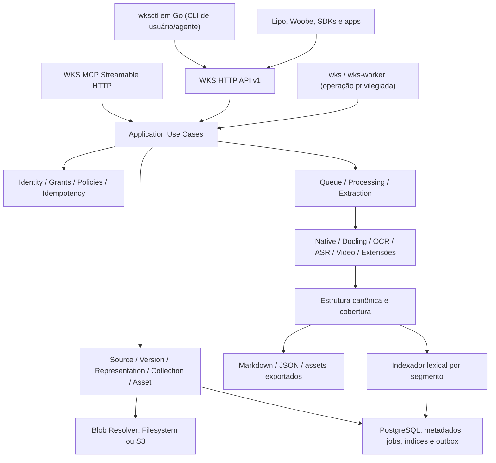

# WKS 1.0.0 — Auditoria de problemas, riscos e plano de estabilização

**Produto:** Woobe Knowledge Server (WKS)  
**Tipo de trabalho:** diagnóstico técnico + especificação de melhorias + critérios de aceite de lançamento  
**Data da análise:** 11/10/2026  
**Base inspecionada:** `A1b3rt0M3rcad0/wks`, branch `master`, commit `a570aac7ed9bb950e7f3f9aae33628fa5f6821bb`  
**Referências de consumidores:** `A1b3rt0M3rcad0/lipo` (`0fd017039f82f7912307a4cb2f988158b5d38bdb`), `A1b3rt0M3rcad0/woobe` (`c9906fa1420492a2c45ff97be990184ee05de5f8`) e `A1b3rt0M3rcad0/woobe-cli` (`2b94000afd6f9b97f7891410c09828f2ce7e7335`).  
**Escopo:** documento de planejamento; **nenhum código dos repositórios foi modificado**.

> **Definição de pronto:** WKS v1.0.0 não é simplesmente um parser com uma busca. É um servidor independente e estável de armazenamento versionado e recuperação de conhecimento, com contratos confiáveis de API, CLI e MCP, execução segura para múltiplos consumidores e provas reprodutíveis de integridade, desempenho, recuperação e isolamento.

---

## 1. Resumo executivo

### 1.1. Veredito

O WKS 0.3.0 oferece uma base real: API FastAPI, serviço de domínio, PostgreSQL 17, armazenamento em filesystem/S3, fontes e representações versionadas, busca lexical via FTS/GIN, workers persistentes isolados por modalidade, Docling, OCR, ASR, processamento de vídeo, MCP remoto de leitura, workspace web, grants, checksums, backup e testes. Não há justificativa para reconstruir esse núcleo.

**Ainda não há evidência suficiente para lançar a v1.0.0 como infraestrutura de conhecimento genérica, estável e performática.** Os principais bloqueadores estão na completude de contratos, operação por agentes, integridade operacional em escala, cobertura de formatos e comprovação real de performance e recuperação. A integração dos consumidores Lipo e Woobe permanece não homologada.

### 1.2. Decisões arquiteturais recomendadas

1. **Preservar a ontologia genérica:** `Client/Principal`, `Namespace`, `Collection`, `Source`, `SourceVersion`, `Representation`, `Block`, `Segment`, `Asset`, `ProcessingRun`, `Grant`, `Receipt`. Nunca inserir conceitos específicos de Lipo (aluno, estudo, roadmap) ou Woobe (Agent Network, Run) no core.
2. **Manter recuperação sem embeddings/vetores para esta versão.** Evoluir Postgres FTS para busca lexical moderna: índices ajustados, busca por frase/proximidade, fuzzy com `pg_trgm`, autocomplete/sugestões controladas, filtros/facetas, highlights seguros, ranking calibrado e navegação hierárquica. Não anunciar busca semântica geral onde ela não existe.
3. **API HTTP como contrato público canônico**; CLI e MCP devem compartilhar casos de uso, autorização, idempotência, estados e referências, sem implementar regras de negócio paralelas.
4. **Criar `wksctl` em Go** como cliente independente para humanos e agentes (o nome `wksclt`, mencionado anteriormente, pode ser mantido como alias caso intencional). Manter o executável Python `wks` para controle interno da instalação; não misturar manutenção privilegiada e cliente remoto.
5. **Expandir MCP para escrita delegada**, mantendo os controles server-side e não permitindo que o modelo selecione seu tenant/namespace de autorização. Arquivos grandes via upload HTTP associado a uma operação MCP autorizada; não trafegar bases64 gigantes em Tools.
6. **Tratar Markdown como artefato derivado versionado e completo**, vinculado à estrutura canônica e aos assets; não substituir os originais por `.md`.
7. **Filesystem e S3 devem oferecer paridade funcional verificada**, com recuperação após falhas e migração explícita; um campo `provider` no banco não basta para hot-swap transparente.
8. **Sem prova, sem claim de suporte:** cada formato e cada capacidade multimodal só será anunciado conforme sua matriz de aceitação e cobertura real.

### 1.3. Não objetivos obrigatórios para 1.0.0

- Embeddings, pgvector, HNSW, bancos vetoriais ou grafo inferido.
- Treinar modelo próprio de OCR/ASR, compreensão universal de imagens/vídeos ou garantia de extração perfeita.
- Substituir o domínio de materiais da Lipo, o runtime da Woobe ou qualquer sistema de workflow externo.
- Marketplace de integrações, conectores privados específicos de SaaS, sincronização bidirecional com todos os serviços de terceiros.
- Executar ações não autorizadas pelo servidor porque um agente solicitou a Tool.
- Distribuir peso de modelo de terceiros sem auditoria de licença.

---

## 2. Critério para separar constatações de hipóteses

- **Confirmado no código:** método, comportamento, schema, rota ou ausência verificável na revisão inspecionada.
- **Confirmado documentalmente:** limitação declarada pelo próprio projeto, benchmark ou evidência do CI.
- **Risco arquitetural:** hipótese tecnicamente plausível derivada do desenho, mas cuja incidência/impacto requer teste de carga, chaos test, pen-test ou operação real.
- **Proposta:** solução ainda não implementada; os exemplos de comando e contrato neste documento representam a interface desejada, não recursos já disponíveis.

**Evidências de qualidade existentes:** o WKS registra 104 testes aprovados e cinco jornadas Chromium na verificação de 09/10/2026. Há release/CI concluídos com sucesso no commit estudado. Isso valida apenas os cenários já instrumentados. O benchmark documenta **100.000 segmentos sintéticos**, **50 consultas**, mediana de **840,56 ms** e p95 de **1.816,01 ms** para busca, em host compartilhado e com atividades concorrentes; não é SLO nem benchmark representativo de recuperação em produção.

### 2.1. Achados e bloqueadores priorizados

| ID | Severidade | Tipo | Achado e evidência | Consequência a enfrentar |
|---|---|---|---|---|
| A01 | P0 | Código | `wks_api/server/cli.py` é servidor/manutenção; não existe `wksctl` completo | Desenvolvimento e operação por agentes locais incompletos |
| A02 | P0 | Código | `wks_api/mcp/server.py` registra seis Tools de leitura | Agentes MCP não criam/revisam/processam/exportam conhecimento |
| A03 | P0 | Código | `openapi.json` apresenta operações e modelos de entrada, mas não esquemas explícitos para respostas de domínio | Consumidores e SDKs sem tipagem de retorno confiável |
| A04 | P0 | Código | `Service.read` retorna Markdown paginado por blocos; representação integral existe no DB, mas não há export/download; `full_block_ref` não possui rota dedicada | Exportação incompleta e referência potencialmente irresolvível |
| A05 | P0 | Código | `maintenance.backup` mantém advisory lock exclusivo durante `pg_dump` e cópia de todos os blobs | Escritas bloqueadas por duração potencialmente proporcional ao corpus |
| A06 | P0 | Documentação/teste | S3 testado com Moto; sem evidência de smoke em bucket S3/MinIO real de produção | Comportamento real de storage e recovery não qualificado |
| A07 | P0 | Código/arquitetura | Escritas de objetos acontecem dentro de transações PostgreSQL (`save_blob`, publicação de assets), sem atomicidade de dois sistemas | Objetos órfãos, contenção e recuperação após crash precisam ser demonstradas |
| A08 | P0 | Documentação | Não há arquivo `LICENSE` na árvore estudada | Licenciamento/distribuição de 1.0.0 indefinidos |
| A09 | P0 | Integração | Nenhuma integração WKS ponta a ponta foi homologada com Lipo ou Woobe | Não atende ainda o critério de produto central compartilhado |
| A10 | P1 | Código | `search` usa `ts_rank_cd`; `snippet = seg.text[:600]`, sem contexto da ocorrência, highlights/fuzzy/facetas nativos | Relevância e DX da busca ficam limitadas |
| A11 | P1 | Código | Idioma do segmento vem de `declared_language`, padrão `pt`, não detecção real | Recuperação degrada para documentos mistos/multilíngues |
| A12 | P1 | Código | Em cada segmento, título da fonte compõe o `tsvector`, além de um bloco extra de metadata | Duplicação de termos no índice e possível viés do ranking |
| A13 | P1 | Código | `read()` carrega `Representation.structure` inteiro de JSONB e pagina no Python | Leituras e memória proporcionais ao documento, não à página solicitada |
| A14 | P1 | Código | Adapter Docling do WKS só é roteado/qualificado para subconjunto de formatos; upstream suporta mais | Upload de formato ≠ extração pesquisável |
| A15 | P1 | Código | Renderizador `markdown(blocks)` concatena blocos e títulos com tratamento simples | Fidelidade de tabelas, imagens, listas, equações e estrutura documental requer qualificação |
| A16 | P1 | Código | `binary_response` revalida ACL/consulta storage por bloco transmitido (~64 KiB) | Custo elevado de DB/S3 em downloads grandes; confirmar com perfilamento |
| A17 | P1 | Código | S3 opera por `put_object` único; upload passa pela API/temporário; sem protocolo multipart/retomada pública | Transferências grandes ou instáveis são ineficientes |
| A18 | P1 | Código | `Core.bootstrap` escolhe um único adapter `filesystem` ou `s3` global | Migração/hibridismo não acontecem automaticamente |
| A19 | P1 | Código | `maintenance.garbage_collect()` materializa lista de todos os keys S3 e Blobs no processo | Sweep O(N) com gasto de listagem/memória em escala |
| A20 | P1 | Código | Não há CRUD completo de update/delete de Namespace/Collection e PATCH de metadados da Source | API/CLI/MCP não oferecem administração plena |
| A21 | P1 | Código | Grants delegados selecionam até 1.000 SourceVersion IDs e ações read/search/asset_read | Não cobrem criação controlada de novas fontes nem delegação por namespace/coleção |
| A22 | P1 | Arquitetura | `Client` possui token provisionado via CLI administrativa; faltam rotação/revogação operáveis por API/CLI de forma robusta | Gestão de credenciais e agents não escala |
| A23 | P1 | Documentação/código | Outbox persistida, mas sem contrato público de eventos consumíveis, replay e entrega | Integração reativa entre produtos incompleta |
| A24 | P1 | Arquitetura | Receipts, auditorias, outbox, jobs e histórico carecem de política explícita completa de retenção/partição | Crescimento de banco e custo com histórico longo |
| A25 | P1 | Operação | Restauração de backup antigo exige reaplicar exclusões/revogações posteriores por processo operacional externo | Possibilidade de reativar dado/credencial revogada se restauração mal executada |
| A26 | P1 | Teste | Métricas atuais predominantemente HTTP; carga de workers, atraso de fila, cobertura e gasto por perfil pouco observáveis | Diagnóstico e capacidade de operação insuficientes |
| A27 | P1 | Código | `Service` concentra ~53 KiB com SQL, idempotência, busca, storage e autorização | Dificulta evolução controlada e testes por caso de uso |
| A28 | P1 | Código | `SourceBody.metadata` aceita apenas valores escalares limitados | Metadados genéricos/estruturados e filtros precisam evoluir |
| A29 | P2 | Capacidade | Normalização de snippets, busca por entidades, navegação por seções e ranking de múltiplos sinais incompletos | Busca menos útil para conjuntos documentais complexos |
| A30 | P2 | Produto | Não há ferramenta pública de avaliação lexical sobre corpus de relevância real | Mudanças de ranking podem piorar resultados sem detecção |

**P0:** bloqueia declaração de 1.0.0 até mitigado e validado. **P1:** indispensável ao escopo central de lançamento, mas pode ser realizado em paralelo após contratos de base. **P2:** desejável para diferenciação; só é gate quando necessário aos requisitos aprovados.

### 2.2. Fontes primárias auditáveis

- Repositório e documentos: https://github.com/A1b3rt0M3rcad0/wks ; `/docs/ACCEPTANCE.md`, `/docs/RELEASE.md`, `/docs/ARCHITECTURE.md`, `/docs/evidence/benchmark.json`, `/docs/verification-2026-10-09-worker-packages.md`.
- API: `/packages/wks-api/src/wks_api/http/app.py`, `/packages/wks-api/openapi.json`, `/packages/wks-api/src/wks_api/contracts/schemas.py`.
- MCP: `/packages/wks-api/src/wks_api/mcp/server.py`.
- CLI atual: `/packages/wks-api/src/wks_api/server/cli.py`.
- Serviço/índice/Markdown: `/packages/wks-core/src/wks_core/application/service.py`.
- Storage/backup/GC: `/packages/wks-core/src/wks_core/storage/storage.py`, `/packages/wks-core/src/wks_core/storage/maintenance.py`.
- Persistência: `/packages/wks-core/src/wks_core/storage/database.py`.
- Workers: `/packages/wks-worker/src/wks_worker/worker.py`, `/packages/wks-worker-docling/src/wks_worker_docling/processing.py`.
- Integração Lipo: https://github.com/A1b3rt0M3rcad0/lipo/blob/master/packages/lipo-api/internal/adapters/study/postgres/planning_sources.go e `/packages/lipo-api/internal/adapters/tutor/postgres/context.go`.
- Integração Woobe: https://github.com/A1b3rt0M3rcad0/woobe/blob/master/packages/woobe-core/src/modules/agent/application/knowledge_strategy_registry.py e `/docs/runtime/MCP_TOOLS.md`.
- CLI de referência: https://github.com/A1b3rt0M3rcad0/woobe-cli/blob/master/docs/OUTPUT.md e `/docs/AGENT_SKILL.md`.

---

## 3. Critérios objetivos da v1.0.0

### 3.1. Funcionalidade mínima obrigatória

1. Cada original autorizado pode ser armazenado, lido de volta byte a byte, versionado e comprovado por SHA-256, independentemente de ser interpretável pelo WKS.
2. Formatos declarados como suportados para recuperação geram estrutura, texto pesquisável, Markdown exportável, locators, assets e informações de cobertura conforme o perfil.
3. Busca textual suporta português/inglês, correspondência exata e por frase, filtros, busca tolerante a digitação, ranking reproduzível, trechos explicáveis, fontes e versões verificáveis; sem vetor.
4. API, `wksctl` e MCP cobrem todas as operações de domínio autorizadas para seus respectivos perfis; administrativo de host (backup/restore/banco/segredos) fica fora do MCP de agents.
5. Workers recuperam tarefas após timeout/crash, não publicam resultados duplicados nem resgatam trabalho de outro perfil.
6. Exclusão e revogação impedem novas leituras em todos os transportes, inclusive em downloads e recursos MCP, com recuperação pós-restore.
7. Integrações de Lipo e Woobe demonstram ingestão, busca, leitura, citações, grants, callbacks/receipts e revogação reais, sem depender de contratos simulados como única evidência.
8. CI reproduz testes sem privilégios, release reprodutível, migrações, rollback compatível, backup/restore e deploy com configuração segura.

### 3.2. Requisitos não funcionais (metas propostas, ainda não medidas)

**Ambiente de referência para estabelecer baseline:** PostgreSQL 17 dedicado com 4 vCPU/16 GiB RAM e armazenamento SSD, API/worker em máquinas/containers independentes, dados de teste gerados publicamente/reproduzíveis. Testar armazenamento filesystem local e um backend S3 real. Validar a configuração final do benchmark antes de afirmar SLO.

| Métrica | Meta inicial de aceitação proposta | Método |
|---|---|---|
| Busca seletiva em 1 milhão de segmentos | p95 ≤ 300 ms, p99 ≤ 800 ms (latência HTTP, sem download de assets) | ≥ 1.000 consultas, ≥ 30 min, 10 namespaces, mistura de queries |
| Busca ampla/fuzzy em 1 milhão de segmentos | p95 ≤ 1.000 ms com limite documentado e orçamento por query | Corpus e concorrência iguais; verificar saturação e índices |
| API de metadados e listagens | p95 ≤ 200 ms para operação indexada | ≥ 100 req/s e parâmetros de paginação típicos |
| Upload e download | Integridade 100% dos objetos aceitos; throughput reportado por tamanho/provider | 1 MiB, 100 MiB, 1 GiB, perda de rede e retry; cumprir quotas |
| Retries de operações | 0 duplicações/0 publicação fora do fencing | Chaos tests; kill API/worker/S3 nos pontos críticos |
| Isolamento | 0 acessos entre namespaces indevidos nos testes | Matriz de grants × transportes × versões × recursos |
| Fidelidade | 100% dos originais preservados por hash; metas específicas por formato para texto/layout | Fixtures conhecidos + amostra real anonimizada |
| Restauração | Restaurar e verificar 100% dos blobs/fontes/refs sob cenário aprovado | Restore em instância separada com ledger de exclusões |
| Sinalização de falhas | 100% dos casos de processamento incompleto têm status/coverage verificável | Testes negativos por extractor/worker |

As latências são **metas de engenharia**, não números já alcançados. Se o baseline mostrar valores inviáveis no hardware escolhido, registrar decisão quantitativa (melhorar plano/índice, reduzir escopo, escalar ou rever alvo) **antes** do anúncio de 1.0.0.

### 3.3. Regras invioláveis

- Nenhuma busca, preview ou exportação pode ampliar o escopo da identidade/grant.
- Nenhum texto gerado ou enviado pelo usuário altera políticas de autorização ou vira instrução confiável do runtime.
- Uma SourceVersion imutável jamais é sobrescrita; nova entrada origina nova versão.
- Um documento que não pôde ser interpretado pode continuar armazenado, mas jamais anunciado como `text_ready` por inferência.
- Nenhuma operação irreversível é declarada concluída antes de efeitos e recibo terminal verificáveis.
- Resultados do benchmark devem mostrar perfil, data, commit, hardware, corpus, p50/p95/p99, throughput, concorrência e limitações.
- Todos os comandos/Tools são controlados por policies do servidor; abstrações locais não elevam privilégios.

---

## 4. Arquitetura-alvo e fronteiras



### 4.1. Regras de camadas

- **Domain:** estados e invariantes portáveis; sem FastAPI, MCP, boto3, ORM, Docling ou SDK de consumidor.
- **Application:** casos de uso de comando/consulta; validação de política, versionamento, idempotência, coordenação transacional, revisão e outbox.
- **Ports:** object store, indexação, extractor, eventos, busca, clock, autenticação, auditoria, parser de contratos.
- **Adapters:** PostgreSQL, filesystem/S3, motores de extração, HTTP, MCP.
- **API:** transporte, auth HTTP, validação e OpenAPI; sem SQL de domínio.
- **MCP:** Tools/read resources que chamam os mesmos casos de uso; sem segundo domínio de permissões.
- **wksctl:** exclusivamente API pública e endpoints operacionais autorizados; nunca acesso direto ao banco.
- **Workers:** decodificadores e estados de execução, sem imports da API ou framework de transporte.

### 4.2. Evolução incremental, sem big-bang rewrite

A classe `Service` atual é funcional, mas centraliza responsabilidades demais. Dividir progressivamente por extratos com testes de regressão: `NamespaceService`, `SourceCommandService`, `SourceQueryService`, `ProcessingService`, `RetrievalService`, `AccessControlService`, `AssetService`, `ExportService`. O objetivo é um portfólio de casos de uso testáveis, não transformar cada método em microserviço.

Manter PostgreSQL como fonte de verdade do estado. Índices especializados e artefatos em objeto são projeções reconstruíveis com versões/generation markers. Não criar múltiplas fontes de verdade para a mesma mutação.

---
## 5. EPIC K01 — Integridade do domínio, contratos de conteúdo e escalabilidade da leitura (P0/P1)

**Objetivo:** sustentar milhares/milhões de documentos sem incoerência entre banco, objetos, índices e representações e sem precisar materializar estruturas inteiras a cada leitura.

### K01.1. Modelo canônico versionado

- Preservar `Source` como identidade de uma entidade documental, `SourceVersion` como imutabilidade do original, `ProcessingRun` como tentativa efetiva, `Representation` como resultado de um processamento específico e `Artifact` como export derivado.
- Definir `representation_schema_version` explícito; exigir compatibilidade/migração gradual de leitores; armazenar `producer`, versão exata, config digest e capabilities.
- Definir `Block` com `id`, `parent_id`, `ordinal`, `kind`, `text`, `data`, `locator`, `origin_kind`, `confidence` quando mensurável, `asset_refs`; usar tipos aprovados (`heading`, `paragraph`, `table`, `list`, `equation`, `picture_ref`, `code`, `transcript`, `metadata`, etc.). `confidence` não pode ser inventado para parsers determinísticos.
- Estabilizar refs `wks://` e permitir resolução exata de `source-version`, `representation`, `block`, `segment` e `asset`, sem fallback implícito para latest.
- Persistir cobertura por modalidade, `coverage_state = complete/partial/unavailable/unsupported`, severidade de warnings e qualidade verificada vs inferida.
- Separar metadados da Source, metadados extraídos e metadados gerados por IA com origem e revisão explícitas.

**Aceite:** exportar/refazer uma representação sem mudar o original; refs antigas continuam resolvíveis enquanto não expurgadas; parse parcial não ganha estado de sucesso total.

### K01.2. Índice de blocos para leitura eficiente

- Introduzir `representation_blocks` normalizado por `representation_id`, `ordinal`, `block_id`, com estrutura ou ponteiro para blob por bloco. Manter `Representation` como identidade e resumo; não obrigar leitura de JSONB gigante para carregar 20 blocos.
- Migrar gradualmente: dual-read por versão; backfill com checkpoint/validação de contagem/hashes; transição de escrita única somente após homologação.
- Expor `GET /v1/representations/{id}/blocks/{block_id}` para resolver integralmente `full_block_ref` com limitação de bytes, paginação de conteúdo quando necessário, e `GET .../blocks` para leitura ordenada.
- Corrigir comportamento de `preview_only` para não produzir resposta acima do limite nem pretender ter entregue o bloco completo.
- Índices `representation_id + ordinal` e `representation_id + block_id`, EXPLAIN ANALYZE e regressão de memória para documentos com dezenas de milhares de blocos.

**Aceite:** consumo de memória do endpoint de leitura cresce com a página e não com todo o documento; `full_block_ref` sempre resolve sob grant válido; idempotência de cursors mantida; revogação prevalece sobre páginas ainda não lidas.

### K01.3. Metadados e mutações de gerenciamento

- Adicionar `PATCH Source` para título, descrição, tags e metadata com `If-Match`/revision; evento auditável. Definir explicitamente quando uma alteração requer reindexar e quando não altera o original.
- Adicionar renomeação/arquivamento de collections e namespaces, com precondições e `delete` somente sob confirmação e relatório de impacto; não apagar em cascata silenciosa.
- Evoluir `metadata` de escalares simples para objeto JSON tipado e limitado em profundidade/tamanho, com schema opcional por namespace e filtros whitelist por campos indexados.
- Definir convenção `external_ref` por cliente/namespace/source para importação idempotente, sem confundi-lo com autorização.
- Adicionar listagem de versões/representações/operações por Source; indicar current vs histórico, erro e partial; expor criação de nova revisão com ETag.

**Aceite:** atualização concorrente detectada por 412; nenhuma operação de metadata sobrescreve bytes históricos; recursos removidos deixam tombstone recuperável para auditoria sem dados pessoais desnecessários.

### K01.4. Máquina de estados e reconciliação DB × Blob

- Modelar transições formais `proposed -> staged -> verified -> committed -> indexed/published`, com `failed/reconcile_required` quando houver dúvida; diferenciar sucesso lógico e limpeza física.
- Adicionar journal de intenção de blob/asset (`BlobOperation`) e reconciliação idempotente: recuperar após crash antes/depois de put, commit DB, publicação de índice e delete físico.
- Reduzir transações longas com operações de rede para S3; combinar staging imutável + commit/attach curto + reconciliação. Não introduzir race de revogação/publicação.
- Validar que indexações nunca aparecem antes de publicação e que índices órfãos podem ser reconstruídos somente a partir de representação publicada.
- Expor receipts estáveis para cada mutação, inclusive `outcome=confirmed|rejected|unknown|reconcile_required` e `operation_id`.

**Aceite:** fault-injection em 20 pontos do fluxo upload/commit/process/publish/delete sem perda de objeto confirmado, acesso indevido ou duplicação de versões. No estado `unknown`, cliente deve conseguir consultar outcome sem repetir mutação cegamente.

---

## 6. EPIC K02 — Armazenamento local/S3, transferência e desastre (P0/P1)

### K02.1. Adapter de storage formal

Definir `BlobStore` tipado: `stage`, `commit/publish`, `head`, `read_range`, `download`, `delete`, `list_prefix_page`, `verify_checksum` (ou declaração de verificação comprovada), `capabilities`, `health`. Implementar os recursos com comportamento equivalente para filesystem e S3, deixando explícitas as operações indisponíveis em providers S3-compatible.

- Provider real registrado para cada Blob (e, se necessário, `bucket/endpoint/region/object_version` opacos); nunca persistir segredo no DB.
- Seleção global de provider permitida na v1, mas **migração deve ser explícita, observável e recuperável**. Para armazenamentos híbridos, resolver por Blob apenas após demonstrar requisitos, não simplesmente mudar variável de ambiente.
- Permitir importação de S3 preexistente **somente** de buckets/prefixos cadastrados/autorizados pelo operador, validando existência, propriedade/alcance permitido, tamanho, content type detectado e checksum.
- Paridade de filesystem com escrita imutável, `fsync` de diretório na promoção quando apropriado e invariantes de path/symlinks; testes no Windows, Linux e em volumes compartilhados.

**Aceite:** mesma suíte de storage contra filesystem, MinIO ou outra implementação S3-compatible certificada, e S3 AWS; cada provider documenta diferenças permitidas.

### K02.2. Upload grande e retomável

- Introduzir sessões de upload multipart/chunked ou `tus`-like, com sequência/offset, digests por parte, expiração, cancelamento e reconciliação; escolher um protocolo só para v1 e implementá-lo consistentemente em API e CLI.
- Transferência deve poder continuar sem reenviar a totalidade após falha de rede. Checksum SHA-256 do objeto completo é autoridade final; ETag S3 **não** é tratado como SHA-256 genérico, especialmente em multipart.
- API deve suportar arquivo sem carregar tudo em memória; clientes apresentam progresso e limites reais. Ações MCP retornam `upload_session_id` e instruções/URL autenticada para o transporte, não um argumento gigante em base64.
- Em S3, usar multipart a partir de tamanho configurado; **100 MB é referência recomendada pela AWS**, não limite obrigatório. Testar cancelamento/abort de uploads incompletos e limpeza de partes órfãs.
- Decidir entre upload proxied (controle de revogação uniforme) e URL pré-assinada extremamente curta/escopada (economia de banda), registrando comportamento de revogação e custos. Não permitir URL pública de download persistente que sobreviva à revogação.

**Aceite:** 1 GB + falha a 50% + retomada + hash íntegro + exatamente uma SourceVersion; operação expirada não publica objetos; nenhum segredo aparece em output/logs de CLI/MCP.

### K02.3. Download e revogação eficientes

- Remover consultas completas repetidas por chunk de 64 KiB e substituir por verificação revalidável de autorização com custo limitado e sem sacrificar a política de revogação. Medir decisão via banco, eventos de revogação e políticas de stream, incluindo cancelamento imediato/bounded e auditoria.
- Adicionar HEAD, Content-Length/Type, ETag, Range, If-Range/If-None-Match, multipart ranges somente se houver caso real; respeitar invalidação das ACLs.
- Responder com checksum e digest metadata para cliente confirmar original ou artefato, inclusive export.

**Aceite:** download 1 GB com DB requests sublineares ao número de chunks e sem acesso após revogação conforme limite documentado e aprovado.

### K02.4. Backup/restore sem travar a instalação

O mecanismo atual mantém lock exclusivo durante `pg_dump` + cópia de todos os objetos. A solução precisa garantir **consistência entre snapshot SQL e bytes imutáveis com bloqueio curto**, não simplesmente retirar o lock.

- Definir corte consistente (`snapshot_id`, high-watermark de eventos, IDs de blobs referenciados) com PostgreSQL MVCC e manifesto de objetos; as gravações posteriores ao corte não precisam entrar naquele backup.
- Separar seleção/certificação de snapshot (operação curta) da cópia incremental de blobs imutáveis em lotes. Preservar bytes referenciados durante cópia por pins temporários/retention. Backups com S3 versionado devem registrar version IDs quando utilizáveis.
- Permitir backup incremental e restore completo, plano PITR para PostgreSQL e restauração de objetos associados, sem presumir que WAL restaura objetos S3.
- Armazenar manifesto assinado ou verificável por checksum, hashes de objetos, versão de schema, commit da aplicação, snapshot de política e condições de replay de exclusões.
- Criar ledger de revogações/exclusões **fora do snapshot antigo que será restaurado**. Ao restaurar, reaplicar os eventos de privacidade e revogação anteriores à abertura de tráfego.
- Testar restore após novos uploads, exclusões, troca de senha, rotação de grant e deploy; definir RPO/RTO e medir em bases grandes.

**Aceite:** backup de corpus grande sem indisponibilidade prolongada de escrita; restaurar em ambiente isolado com referências e ACLs coerentes; dados excluídos após o snapshot permanecem inacessíveis depois da restauração.

### K02.5. Retenção, custos, integridade contínua

- Configurar retenção separada de originais, representações, assets derivados, audit logs, events, jobs, receipts, checkpoints, uploads abandonados e backups; manter fontes imutáveis enquanto referenciadas, com tombstones mínimos.
- GC incremental com cursor/checkpoints por prefixo; não materializar todas as keys S3 numa lista; quarentena/grace antes de excluir órfão; tolerância a listagens inconsistentes de provedores compatíveis.
- Detectar objeto desaparecido/corrompido, emitir alerta e impedir status `ready` falso quando capacidade crítica estiver indisponível; índice e derivados podem ser reconstruídos, originais não.
- Métricas de bytes efetivos, custo por modalidade, deduplicação segura **somente dentro de namespace** se adotada, sem vazamento de existência/tempo entre tenants.

**Aceite:** sweep de 1 milhão de objetos com memória limitada e retomada; simulações de objeto faltante e tombstone preservam propriedades de retenção.

---

## 7. EPIC K03 — Processamento universal, multimodal e registry de formatos (P0/P1)

### K03.1. Catálogo transparente de formatos

Criar `FormatRegistry` e `ProcessorCapabilities` com `detected_mime`, `format`, `can_store`, `can_extract`, `extractor_name/version`, `supported_modalities`, `max_input_size`, `max_pages`, `quality_level`, `requires_models`, `availability`. Um formato pode ser **aceito como blob** sem ser **suportado para extração**. A matriz se baseará em testes do WKS; não copiar automaticamente a lista do Docling upstream.

**Matriz-alvo para 1.0.0 (a validar por fixtures):**

| Classe | Formatos-alvo | Entrega mínima de processamento | Prioridade |
|---|---|---|---|
| Texto/código | TXT, MD, HTML, JSON, YAML, XML, CSV, arquivos de código conhecidos | Texto + locators + Markdown adequado | Obrigatório |
| Documentos | PDF nativo/escaneado/misto, DOCX, PPTX | Texto, páginas/seções, tabelas/figuras localizáveis, OCR sob perfil | Obrigatório |
| Planilhas | XLSX, ODS; CSV já existente | Sheets/linhas, tabelas, formulas com proveniência/sem execução | Obrigatório |
| E-books | EPUB | capítulos, headings, notas e imagens vinculadas | Obrigatório |
| Imagens | PNG, JPEG, TIFF, WEBP, BMP | Original, OCR, dimensões, locators; descrição visual só sob provider qualificado | Obrigatório |
| Áudio | WAV, MP3, M4A, FLAC, OGG | ASR com timestamps e coverage explícita, se habilitado | Perfil qualificado |
| Vídeo | MP4, MOV, WEBM | Frames amostrados + áudio transcrito + timestamps; não prometer visão temporal plena | Perfil qualificado |
| Documento legado | RTF, DOC, XLS, PPT | Conversão sob sandbox/LibreOffice opcionais, se qualificados | Desejável |
| Outros estruturados | EML, MBOX, ODT, ODP, AsciiDoc, LaTeX | Extração tipada se houver decoder testado | Desejável |
| Binários sem extractor | outros MIME | Bytes retidos, `unsupported_processing`, download íntegro | Obrigatório |

O Docling upstream descreve suporte amplo (Office, EPUB, formatos abertos, email, imagens, etc.), mas o adapter do WKS precisa implementar identificação, preservação e testes por formato antes de anunciá-los.

### K03.2. Pluginização controlada de extractors

- Definir interface `Extractor.accepts(media_type, magic_bytes, policy)` e `Extractor.extract(input, config, budgets) -> ExtractedRepresentation`; registry por perfil com ordem determinística.
- Manter runtime de worker isolado do API/Core; cada pacote opcional instala somente suas dependências de OCR/Office/ASR específicas.
- Revisão/hash pinado de modelos e bibliotecas; reprocessamento explícito gera nova Representation, preservando histórico.
- Definir fallback policy: `strict`, `prefer_docling`, `native` e `auto` documentado; fallback deve registrar causa, qualidade e cobertura, não mascarar conversão parcial.
- Validar formatos detectados por bytes e arquivo interno, não pelo nome; arquivos perigosos, macro e ZIP bombs bloqueados/sandboxed antes do decoder.

### K03.3. Fidelidade documental e qualidade

- Criar amostras gold-standard contendo títulos multinível, listas, tabelas mescladas, hyperlinks, código, equações, citações, imagens, rodapés, ordem de leitura, PDFs em duas colunas, OCR em português, páginas sem texto e documentos com várias línguas.
- Normalizar unidades e proveniência para planilha (sheet/row/column), documento (page/bbox/section), áudio/vídeo (`start_ms/end_ms/frame_index`) e web (URL capturada + hash + timestamp).
- Introduzir `ExtractionQualityReport`: textos aceitos/rejeitados, warnings, missing pages, figuras, cobertura, `unknown`/não medido; não usar pontuação de acurácia fictícia.
- Gerenciar CPU/memória/páginas/duração/frames por entrada, deadline, sandbox e stop seguro para decoders externos; impedir network e execução de macros/scripts.
- Permitir reprocessamento em lote filtrado por versão do processor, material incompleto e ausência de indexação, com dry-run e quota.

**Aceite:** 100% dos casos de formato declarados suportados possuem fixture, teste e resultado exportável verificável; extractor desabilitado mantém os bytes e estado honesto; integridade dos originais independe do sucesso de extração.

### K03.4. Enriquecimento multimodal opcional

- OCR não equivale à compreensão de diagramas; ASR não interpreta sons não verbais; frames de vídeo não representam entendimento temporal contínuo.
- Introduzir adapters opt-in para descrição visual/equações quando autorizados por política, com versão de provider, controle de custo, proveniência `ai_description`, confidencialidade e reprocessamento.
- Descrição produzida por IA jamais substitui conteúdo original, e busca deve permitir filtro por origem (`native`, `ocr`, `transcribed`, `ai_description`).
- A entrega MCP de um link de asset não significa que o modelo o consumiu: `delivery_status` deve indicar essa distinção até teste real do consumidor.

---

## 8. EPIC K04 — Markdown, exportação, empacotamento e referências (P0/P1)

### K04.1. Markdown como artefato verificável

- Desenvolver renderizador determinístico sobre o schema canônico com suporte a headings, parágrafos, listas/nesting, tabelas, linhas, imagens, links, blocos de código e expressões matemáticas conforme disponibilidade real.
- Separar `markdown_body`, `markdown_manifest`, `assets` e `render_warnings`; texto gerado precisa preservar proveniência e marcação de regiões não compreendidas.
- Manter `Representation.markdown` como compatibilidade/projeção simples inicialmente, mas ter API de export integral/streaming e artefato persistível por checksum/version.
- Formatos propostos: `markdown-single`, `markdown-bundle` (ZIP com md/assets/manifest), `structured-json`, `plain-text`, `source-original`. Não apresentar HTML/PDF gerado como obrigatório para 1.0.
- Renderização não interpreta Markdown não confiável como comandos e não insere código remoto ao fazer preview/export.

### K04.2. APIs de export e leitura

- `POST /v1/representations/{rid}/exports` cria intenção idempotente (formato, assets, referências, profile).
- `GET /v1/exports/{export_id}` acompanha progresso, estado, hash, byte size, warning e vínculo imutável.
- `GET /v1/exports/{export_id}/content` transmite o resultado autenticado, com Range quando suportado.
- `GET /v1/representations/{rid}/blocks/{block_id}` devolve bloco completo/parte aprovada; nunca depender de Markdown concatenado para citar.
- `GET /v1/representations/{rid}/outline` e `GET .../read` fornecem ordem e paginação consistentes; normalizar `next_cursor` e `complete`.

### K04.3. Manifesto portátil

Exemplo **proposto**, não implementado:

```json
{
  "manifest_schema_version": "1.0",
  "source_ref": "wks://sources/<source_id>/versions/<version_id>",
  "representation_id": "<representation_id>",
  "format": "markdown-bundle",
  "producer": {"name": "wks-markdown", "version": "1.0.0"},
  "files": [
    {"path": "document.md", "sha256": "<sha256>"},
    {"path": "assets/figure-001.png", "sha256": "<sha256>"}
  ],
  "coverage": {"text": "complete", "visual": "partial"},
  "warnings": []
}
```

- Assets referenciados no Markdown usam caminhos relativos portáveis dentro do bundle; URI `wks://` deve constar no manifesto como referência de proveniência.
- Export idempotente para mesmos digest de origem + renderizador + opções; versões diferentes produzem export distinto.
- ZIP não permite Zip Slip e não embute credenciais. Imports de bundle devem verificar integridade e identidade de referências sem confiar em IDs externos como autorização.

**Aceite:** export integral de representação com 10.000 blocos sem faltar/duplicar conteúdo, checksum reprodutível, refs de imagens válidas, leitura paginada e revogação que bloqueie export/download subsequente.

---

## 9. EPIC K05 — Busca moderna, altamente relevante, sem vetores (P0/P1)

### K05.1. Correções imediatas na busca atual

- Remover dependência de `snippet = texto[:600]` e gerar trechos ao redor de correspondências, respeitando delimitadores textuais, tamanho máximo, múltiplas ocorrências e **highlight seguro**. Tratar output como texto, nunca HTML executável.
- Evitar propagação do título de Source para o `tsvector` de todos os segmentos sem distinção; manter índice de metadata separado ou campo ponderado que não gere falso positivo em qualquer chunk.
- Definir retorno com `match_origin`, `match_positions`/highlights, `score` calibrado apenas **relativamente à consulta**, `source_version_ref`, `segment_ref`, `locator`, `coverage` e `retrieval_generation`.
- Garantir paginação determinística e high-watermark sob novas publicações, revogação e concorrência. Não vazar existência de outros tenants por sugestões/facetas.
- Diferenciar filtros hard (`namespace`, `collection`, `source`, `version`, `media_type`, `language`, `created_at`, `origin_kind`) de boosts de ranking.

### K05.2. Estratégias lexicais modernas

1. **Exact/phrase/proximity** sobre PostgreSQL FTS, com `websearch_to_tsquery`, `phraseto_tsquery` e operadores de proximidade onde aplicáveis.
2. **Fuzzy/typo-tolerant** usando `pg_trgm` sobre vocabulário/sinais indexados, com limiar e limite por query; somente tentar fuzzy quando necessário, evitando scans amplos.
3. **Autocomplete/sugestões** derivadas de termos autorizados no namespace e atualizadas incrementalmente. Nunca usar vocabulário global compartilhado entre tenants sem isolamento comprovado.
4. **Dicionários/sinônimos** por idioma e eventualmente namespace. Não ampliar para termos semanticamente divergentes sem avaliação de precisão; versão da política e auditoria.
5. **Ranking de dois estágios**: recuperar candidatos indexados e reordenar um conjunto limitado por match de título, densidade, proximidade, campo, segmento, preferências explícitas e deduplicação por Source; usar RRF apenas quando houver múltiplas listas independentes e métricas que justifiquem.
6. **Navegação estrutural**: ao recuperar segmento, retornar trecho anterior/posterior e caminho de headings; leitura hierárquica selecionada reduz custo de contexto de agentes.
7. **Multilíngue**: `pt`, `en`, `simple` com política de identificação por representação/segmento (incluindo mistos); retornar `language_detected` e confiança quando algoritmo a fornecer de fato.
8. **Facetas**: contagens autorizadas por MIME, coleção, tags, idioma e origem, com limites e políticas anti-inferência entre tenants.

**Importante:** `ts_rank_cd` NÃO é BM25. Se benchmarks de qualidade justificarem BM25, avaliar engine PostgreSQL/extensão ou indexador lexical externo, acompanhando licenças, custo, consistência, isolamento, backup e reconstrução. Não introduzir Meilisearch/Elasticsearch/Tantivy só por número de estrelas.

### K05.3. Plano de consulta e índices

- `EXPLAIN (ANALYZE, BUFFERS)` em consultas altamente seletivas, comuns e amplas; analisar planos sob filtros de namespace/collection, tamanho de índice, `work_mem`, parâmetros e estatísticas.
- Comparar GIN FTS, índices compostos por escopo, trigram com GiST/GIN e particionamento apenas se demonstrado. Uma consulta ampla pode legitimamente preferir Seq Scan; não tratar Seq Scan isoladamente como bug.
- Tratar timeout por query, top-k limite, budget de caracteres, max facets e número de candidatos para impedir consumo excessivo de CPU.
- Para corpora grandes, avaliar índice especializado apenas atrás de `SearchPort`, com dual-index + testes de equivalência, replay de outbox e migração reversível.
- Instrumentar métricas de latência de parse, filter, candidate, rerank, hydration e serialização; separar tempo de indexação vs consulta.

### K05.4. Avaliação quantitativa de relevância

Criar datasets testáveis com 300+ queries qualificadas em português e inglês: técnica, educativa (Lipo), documentação operacional (Woobe), abreviações, typo, sinônimo, frase literal, termo raro, multimodal com transcrição, atualização de versão e negativas. Cada query possui juízos de relevância `qrels` e fontes apropriadas.

Métricas sugeridas, recalibradas depois do baseline:
- `Recall@10`, `Precision@5`, `MRR@10`, `nDCG@10`, cobertura de citação e taxa de resposta sem resultados quando deveria haver.
- Testar variação por idioma/formato, fonte e corpus; não esconder regressões de subgrupos com média global.
- Gate inicial desejado: `Recall@10 ≥ 0,85`, `nDCG@10 ≥ 0,80` no conjunto gold aprovado e nenhuma regressão maior que 2 pontos percentuais sem justificativa aprovada.
- Rank lexical é evidência de correspondência, **não probabilidade de veracidade nem confiança factual**.

**Aceite:** comparação before/after com corpus realista, sem vectors, decisão fundamentada sobre extensão/engine e metas de desempenho verificadas no mesmo hardware.

---
## 10. EPIC K06 — API HTTP pública, compatibilidade e SDKs (P0/P1)

### K06.1. Contrato OpenAPI como fonte de verdade

- Versionar `openapi.json` e definir **response models tipados para 100% das operações públicas**, incluindo envelopes de erro, resultados assíncronos, paginação, metadados de autenticação e downloads binários.
- Padronizar nomes `operationId`, IDs, tipos de timestamps ISO-8601, status, enums, headers obrigatórios e schemas de idempotência. Manter OpenAPI 3.1 e exemplos reais gerados por testes.
- Implementar `schema compatibility diff` no CI: nenhuma remoção/mudança incompatível em `/v1` sem nova versão maior e roteiro de migração.
- Definir `GET /v1/capabilities`: versão do servidor, perfil dos workers e formatos disponíveis, limites de upload/export, modos de busca, versões MCP e recursos condicionados; descoberta **não confere autorização**.
- Manter documentação de API manual sincronizada automaticamente com o OpenAPI, com snippets reais para Python, Go e curl.

### K06.2. Ciclo completo de recursos

Endpoints de referência **propostos**, sujeitos a aprovação de contrato antes da implementação:

| Superfície | Operações essenciais |
|---|---|
| `/v1/namespaces` | list/get/create/patch/archive e gestão explícita de lifetime |
| `/v1/collections` | list/get/create/patch/archive, vincular/desvincular e estatísticas |
| `/v1/sources` | list/get/create/patch/revoke/delete, versões, representações e processamento |
| `/v1/uploads` | create/chunk/list parts/finalize/abort/status/reconcile |
| `/v1/operations` | list/get/wait-or-poll/reconcile e receipt por idempotency key |
| `/v1/search` | lexical/phrase/proximity/fuzzy, filtros, facetas, highlights, cursors |
| `/v1/representations` | get/outline/read/blocks/export com refs exatas |
| `/v1/assets` | metadata/content/range/verified digest |
| `/v1/exports` | iniciar, consultar e baixar Markdown/bundle/JSON |
| `/v1/references/verify` | validação server-side de citações/revisões |
| `/v1/grants` | create/get/list/revoke com escopo por operação |
| `/v1/events` | consulta de eventos outbox autorizados com replay/cursor |
| `/v1/clients` | identidade operacional, rotação/revogação de credenciais, somente administração autorizada |

### K06.3. Contrato de resposta/erro

Definir shape estável, por exemplo:

```json
{
  "data": {"source_id": "...", "source_version_id": "..."},
  "meta": {"request_id": "...", "operation_id": "...", "complete": true},
  "error": null
}
```

- Para erros, incluir `code`, `message` sanitizada, `request_id`, `retryable`, `write_outcome` (quando mutação), `details` seguros e documentação de remediação.
- Respostas de coleções incluem `items`, `next_cursor`, `complete` e escopo efetivo; nunca assumir que uma página é a coleção inteira.
- 401/403/404 devem preservar política anti-enumeração; 409 para idempotency conflict; 412 para revisão de recurso divergente; 429 com Retry-After; 503 para dependência indisponível.
- Envelopamento de binários, SSE e MCP pode diferir do JSON; padronizar sem quebrar MIME, caching e semântica HTTP.
- `Idempotency-Key` deve ser reconsultável por `(client, key, payload_hash)`; retries podem recuperar resultados sem repetir escrita.
- Timeouts, requests enormes e operação assíncrona: 202 + `Location`/operation status, sem prometer processamento síncrono.

### K06.4. SDKs oficiais e webhooks/eventos

- `wks-sdk-go` e `wks-sdk-python` com operações tipadas, streaming, paginação lazy, retries apenas seguros, metadata de erro, recebimento de eventos e resolução de refs.
- Compatibilidade gerada do OpenAPI + pequenas abstrações de alto nível (`UploadFile`, `ExportMarkdown`, `WaitOperation`, `SearchAll`, `VerifyReference`).
- Integração da CLI Go deve reutilizar o client SDK, sem outra biblioteca HTTP paralela.
- Outbox delivery worker separado para webhook HTTPS com assinatura HMAC/nonce/retry/DLQ, além de API de replay autenticada e SSE opcional. Primeiro implementar cursor/replay, só depois webhooks; não é necessário manter SSE permanente para cada consumer.
- Evento com `event_id`, `type`, `schema_version`, `resource_ref`, `namespace_ref`, `occurred_at`, `operation_id`, sequência e checksum; **sem texto integral nem credenciais nos payloads**.

**Aceite:** OpenAPI tipa todos os retornos; dois SDKs concluem casos de uso reais; contrato compatível entre releases; eventos podem ser redelivered sem duplicar estado no consumidor.

---

## 11. EPIC K07 — MCP completo para agentes, seguro e interoperável (P0/P1)

### K07.1. Regras de produto

O MCP WKS não será um segundo backend: é **uma superfície de ação controlada** do mesmo Application Service. Expor Tools mínimas, tipadas e fáceis de descobrir; não publicar indiscriminadamente todas as rotas HTTP como Tools (polui contexto do modelo e amplia a superfície operacional).

- Manter Streamable HTTP como transporte remoto principal; avaliar `stdio bridge` apenas como launcher local para hosts que precisem desse transporte, usando cliente HTTP/SDK, sem autoridade própria.
- `tools/list` determinístico, versionado, potencialmente filtrado por escopo autorizado; descrever limitações e `outputSchema` real.
- `readOnlyHint`, `destructiveHint`, `idempotentHint` conforme semântica. Annotations orientam clientes, mas **não** autorizam servidor.
- Limitar tamanho de resposta, suportar cursor/`next_cursor`, retornar `structuredContent` e `isError` com códigos estáveis, não dumping de traceback.
- Não solicitar tokens, IDs de tenant ou secrets em argumentos de Tools; ler contexto protegido do transporte e resolver scope server-side.
- Não gerar bytes extensos para upload em base64 em argumento do modelo. Operações assíncronas retornam handle opaco e instruções de transferência/autorização específica.

### K07.2. Catálogo-alvo de Tools (sugestão)

| Grupo | Tool | Capacidade |
|---|---|---|
| Discovery | `wks_capabilities` | Ler formatos, limites e ações visíveis |
| Discovery | `wks_list_namespaces` / `wks_list_collections` | Enumerar apenas escopos permitidos |
| Discovery | `wks_list_sources` / `wks_get_source` | Catálogo/metadata autorizada |
| Ingestão | `wks_create_text_source` | Criar texto pequeno com idempotência |
| Ingestão | `wks_create_upload` | Abrir transferência out-of-band com handle |
| Ingestão | `wks_finalize_upload` | Completar/verificar upload autorizado |
| Ingestão | `wks_import_allowed_object` | Importar objeto em origem registrada pelo operador |
| Gerenciamento | `wks_create_collection` / `wks_attach_source` | Compor e organizar fontes |
| Gerenciamento | `wks_update_source_metadata` | Corrigir título/tags com precondição |
| Versões | `wks_create_source_version` | Nova revisão imutável |
| Processamento | `wks_process_source` / `wks_get_processing_status` | Processar e consultar progresso |
| Retrieval | `wks_search` / `wks_outline` / `wks_read` | Busca, navegação e leitura |
| Retrieval | `wks_read_block` / `wks_read_asset` | Blocos integrais e recurso multimodal |
| Retrieval | `wks_verify_reference` | Validar fonte e citação |
| Export | `wks_export` / `wks_get_export_status` | Gerar/consultar Markdown bundle |
| Lifecycle | `wks_revoke_source` / `wks_delete_source` | Operações restritas/destrutivas |

O conjunto exato deve equilibrar autonomia e custo de contexto; Tools menos frequentes podem aparecer por grupos/capabilities. Não fazer `delete_source` disponível para um executor com permissão apenas de busca.

### K07.3. Autorização de escrita delegada

O `Grant` atual só permite `read/search/asset_read` sobre uma lista de SourceVersions e expira em até uma hora. Criar contrato evolutivo com:

```yaml
issuer_client: service-owner
caller: woobe-executor
scope:
  kind: namespace
  ref: authorized-namespace-id
actions:
  - source:create
  - source:read
  - source:process
  - search:query
purpose: "knowledge ingestion during agent run"
ttl_seconds: 900
```

- Suportar grants por Namespace/Collection/SourceVersion/Asset e ações nomeadas; permissões de escrita nunca herdadas de simples acesso de leitura.
- Autorização reforçada em cada operação, inclusive `tools/list`, `tools/call`, `resources/read`, previews, exports, downloads, polls e cursores.
- Grant é emitido por autoridade externa confiável e vinculado a client, audience, escopo, purpose e expiração. WKS não precisa conhecer `student_id`, `agent_id` ou `tenant_id` do consumidor; pode receber external ref opaca e server-side.
- Aplicar quotas/rate limits por principal + namespace + ação; certas ações destrutivas exigem preflight explícito/confirmation receipt emitido pelo servidor, além de política do host.
- Compatibilizar modelo de Bearer atual com OAuth discovery quando necessário para clientes MCP externos; testar revisão de protocolo atual e anterior de acordo com suporte dos SDKs, sem alegar compatibilidade não executada.

### K07.4. Paridade e testes de interoperabilidade

- Testar cliente MCP oficial Python + ao menos um cliente independente, com headers de grant, descoberta, `tools/call`, `resources/read`, streaming, encerramento e revogação entre chamadas.
- Testar com Woobe real (MCP provider `streamable_http`, policy review/allow/deny e external context), uma sessão longa e outra com token expirando durante o trabalho.
- Testar operabilidade com Codex/Claude conectados a servidor MCP: capacidade real de listar, inserir texto, procurar, revisar, exportar e recuperar após timeout, sob grant escopado.
- Verificar que `read_asset` com resource link **não** declara envio de imagem ao modelo até haver teste do client multimodal em questão.

**Aceite:** todos os casos de domínio autorizados podem ser executados via Tools apropriadas ou transferência HTTP originada pela Tool; não há bypass de ACL, e respostas permanecem determinísticas para automação.

---

## 12. EPIC K08 — `wksctl`: DX, automação e manipulação por agentes (P0/P1)

### K08.1. Forma de entrega

- Criar repositório/pacote de cliente Go independente do runtime WKS, preferencialmente `wksctl` com Cobra; distribuição binária Linux/macOS/Windows (amd64/arm64 conforme demanda), checksums e provenance.
- Manter scripts administrativos `wks api`, `wks backup`, `wks restore`, `wks reindex`, workers no serviço Python, sem expô-los como comandos remotos inseguros.
- CLI sempre interage com API HTTP; não conecta PostgreSQL e não acessa bucket diretamente, salvo um upload autorizado por sessão protocolada pela API.
- Distribuir opcionalmente via npm como wrapper de binário, mas **não tornar npm requisito** para uso nativo. A versão CLI pode divergir da versão do servidor, sob matriz de compatibilidade explícita.
- Expor `version`, `capabilities`, `doctor`, `help --output json`, `schema --command`, `validate-input`, `auth status` antes de operações.

### K08.2. Organização por comandos

```text
wksctl
  context       add | list | use | show | delete
  auth          login | logout | status | rotate (quando autorizado)
  doctor        [--deep] [--output json]
  capabilities  [--output compact]
  namespace     list | get | create | update | archive
  collection    list | get | create | update | archive | attach | detach
  source        list | get | add | upload | text | update | versions | process | revoke | delete | export
  operation     get | wait | list | reconcile
  search        QUERY [--mode lexical|phrase|fuzzy] [--namespace ...]
  read          REF [--outline] [--output text|markdown|json]
  asset         inspect | download | verify
  export        create | status | download
  grant         create | list | inspect | revoke
  sync          plan | apply | status | reconcile
  manifest      validate | diff | plan | apply
  test          run | report | fixtures
  skill         install | status | uninstall
  schema        --command ...
  version
```

Exemplos **propostos**:

```bash
wksctl context add local --api-url http://127.0.0.1:8080
wksctl context use local
wksctl auth login --token-stdin
wksctl init --agents codex,claude
wksctl namespace create --title "Projeto A"
wksctl source upload ./documents/manual.pdf --namespace @projeto-a --wait
wksctl source get SOURCE_ID --output compact --fields id,title,availability
wksctl search "circuitos em paralelo" --namespace @projeto-a --mode lexical --output compact
wksctl source export SOURCE_ID --format markdown-bundle --out ./exports
wksctl manifest validate --file .wks/sources/manuals.yaml
wksctl sync plan --dir ./knowledge --namespace @projeto-a
wksctl test run .wks/tests/retrieval.yaml --output json
wksctl doctor --deep
```

### K08.3. Contrato de saída favorável a agentes

| Modo | Finalidade | Contrato |
|---|---|---|
| `text` / `table` | humano | tabelas/linhas legíveis; IDs recuperáveis |
| `compact` | AI agents | JSON enxuto com ID, ação seguinte, resultado e metadados essenciais |
| `json` | integrações | envelope completo versionado sem omissões |
| `jsonl` | operações longas | eventos por linha com sequência, estado e resultado terminal |
| `--fields` | ambos | projeção estável de campos; sem esconder erros ou cursor |

- `stdout` contém somente dado solicitado; diagnostics/logs em `stderr`. ANSI off ao detectar máquina/pipeline.
- Exit codes estáveis para inválido, autenticação, autorização, not found, conflito, temporário, resultado incerto, partial, timeout e teste com falha.
- Nunca converter exceção/rede falha após write em `success`; reportar `write_outcome=unknown` e comando de reconcile correspondente.
- Paginação automática opt-in e flag `--all`; `meta.complete=false` e `next_cursor` sempre visíveis no modo machine. `--fields` não pode apagar evidência de falha/completude.
- Help estruturado para ferramentas do agente descobrirem operações permitidas e parâmetros, sem depender do README.
- Consumir API OpenAPI para validação tipada e diff de contrato em CI; não gerar CLI cegamente para rotas privilegiadas.

### K08.4. Desenvolvimento local como código

Formato de workspace recomendado:

```text
.wks/
  project.yaml            # endpoint/namespace aliases sem segredos
  sources/
    manuals.yaml          # fontes externas, caminhos, tags e opções
    policies.yaml         # opções não secretas de extração/consulta
  tests/
    extraction.yaml
    retrieval.yaml
  .state/                 # ignorado no Git; cursores/receipts/checkpoints
    sync.json
    operations.json
```

- `wksctl init` cria/reutiliza diretórios com dry-run, sem apagar arquivos preexistentes.
- `sync plan` calcula SHA-256 dos arquivos locais, compara SourceVersion remota, detecta versões atualizadas e emite ações; `sync apply` exige confirmação nas mutações (ou `--yes` sob grants permitidos); `sync reconcile` reconsulta receipts quando resposta foi perdida.
- `manifest validate/diff/plan/apply` cobre nomes, refs, coleções, tags, metadata, arquivos e policy. IDs remotos ficam em receipts/config local; YAML não traz token nem storage key.
- Sincronização não apaga remotos por ausência de arquivo local sem `--prune` explícito, relatório de impacto e permissão adequada.
- Cache local não é autoridade, e arquivos locais não representam diretamente Production de qualquer outro produto. Versão remota selecionada deve ser visível.
- `wksctl test run` usa namespace isolado e dados de fixture; jamais limpeza indiscriminada no namespace real.

### K08.5. Agent Skills

- Embutir skill compatível com Codex/Claude e outros hosts Agent Skills, instalável por `wksctl init --agents ...` e `wksctl skill install`.
- Instruir o agente a verificar `context`, `capabilities`, `auth status`, documentação da ação, política de escrita, `--dry-run`, retorno/receipt e reconciliação.
- Prover exemplos de manipulação incremental sem enviar todo o corpus para contexto do modelo.
- Incluir instalações Windows (PowerShell) e Linux/macOS, testes de shell escaping, Unicode/path spaces, partial downloads, HTTP/SSE e ausência de segredos.

**Aceite:** um agente local realiza de ponta a ponta: conectar, criar namespace, enviar PDF, acompanhar processamento, pesquisar, ler ref, exportar `.md`, adicionar uma segunda revisão e conferir que a primeira permaneceu acessível; tudo pelo `wksctl`, sem UI nem SQL.

---

## 13. EPIC K09 — Segurança, multi-tenancy e governança (P0/P1)

### K09.1. Identidade, escopos e autorização

- Estabilizar distinção `human account` vs `client` vs `executor` vs `grant`; ações permitidas são combinadas com identidade, namespace e recurso a cada operação.
- Credenciais de integração: criação, rotação sobreposta com prazo limitado, revogação, descrição, última utilização e trilha auditável; segredo nunca aparece em resposta após provisioning.
- Rotação/escopo para WKS multi-instância sem token mestre público. CLI armazena credenciais preferencialmente em keychain/credential manager ou arquivo local restrito, com capacidade `--token-stdin` para CI.
- Grants expiram, são revogáveis e restringem source/version/namespace/collection/actions; grants de escrita curtos, por job quando adequado; bloquear ampliação via parâmetros enviados pelo modelo.
- Defesa contra enumeração: requests com recurso desconhecido/inacessível retornam erro uniforme e timings que não exponham detalhes relevantes, dentro do viável.
- Definir política de usuários humanos adicionais/roles se houver administração multiusuário na v1; atualmente bootstrap da primeira conta é intencionalmente fechado. Se não implementado, documentar deployment com administrador único como limite formal.

### K09.2. Documentos hostis e limites de exploração

- PDFs, ZIP/Office, imagens, áudio/vídeo, HTML, EML e arquivos de código são entradas não confiáveis; parsers em subprocesso isolado, sem acesso de rede por padrão e com timeout/CPU/memória/disco/cgroup.
- Desabilitar macros/execução de scripts; impedir decompression bomb, path traversal, XXE (XML), SSRF e chamadas indiretas em conversores; sanitizar previews HTML/Markdown.
- Tratar links externos em documento como dados, sem auto-fetch. Captura HTTP pública apenas com opt-in e validação de DNS/IP/redirecionamento a cada hop.
- Origin/provider de enriquecimento configurável sob allowlist rígida; proibir envio de documento privado para serviço de IA sem política de transferência permitida.
- Definir limites de JSON/query, tokens de busca, quantidade de filtros, facets, exports, chamadas simultâneas, upload, páginas, frames e operações pendentes por namespace.

### K09.3. Dados pessoais, expurgo e licenciamento

- Tratar documentos como potencialmente sensíveis (inclusive dados educacionais); sem texto/arquivo em métricas, traces, outbox pública ou falhas de validação.
- Garantir deleção lógica imediata e expurgo físico reconciliável do ativo; gravar tombstone sem conteúdo; registrar modo de eliminação dos backups e condições legais de retenção.
- Simular restauração antiga após revogação, expurgo, rotação de credenciais: eventos mais recentes devem prevalecer antes do ingress abrir.
- Definir `LICENSE` do WKS (Open Source vs Source-Available) por decisão do produto. A escolha não é feita neste documento. Publicar THIRD_PARTY_NOTICES, atribuições de bibliotecas e auditoria de pesos/modelos, licença do Docling, Tesseract, FFmpeg, ASR e extras opcionais.
- SBOM, varredura de dependências e containers, execução não-root, assinatura/attestation quando viável, atualização de CVEs crítica antes do release.

**Aceite:** suíte automatizada de authorization-matrix negativa em HTTP/MCP/CLI; fuzzing e limites por modalidade; nenhum segredo/log sensível nos artefatos; licença e notices revisados por responsável.

---
## 14. EPIC K10 — Operação, observabilidade, jobs e disponibilidade (P0/P1)

### K10.1. SLO, readiness e capacidade

- `liveness` indica apenas processo respondendo; `readiness` verifica DB, schema, storage e dependências críticas daquele deployment; adicionar `capabilities/health` por fila (native/docling/media), modelos carregados e status dos provedores opcionais.
- Uma API pode estar `ready` para leitura e `degraded` para ingestão de áudio; endpoint e métricas precisam distinguir indisponibilidade parcial por capacidade.
- Métricas de fila: backlog por tipo, idade máxima, throughput, taxa de erro, attempts, retry_wait, lease expirado/fencing, recursos de CPU/memória por perfil, tempo de extração por formato, publish/commit/rollback, bytes lidos/gravação S3 e índice por namespace sem cardinalidade de IDs.
- Métricas de busca: p50/p95/p99 por modo e buckets de corpus, match count, timeout/partial, planos degradados, cache hit, latência de hydration, query expansion usada; não gravar texto integral de consultas sensíveis.
- Structured logging com correlation ID, operation_id, request_id, resource_kind, result code; `trace_id` opcional OpenTelemetry com scrubbing de origem/documento/segredo.
- Alertas: fila parada, processamento atrasado, storage indisponível, dados originais faltando, expurgo pendente, restore inconsistente, erro de worker, crescimentos anormais de índice e S3/DB, aumento sustentado de p95, quota 80%.

### K10.2. Scheduler/worker de processamento

- Manter fila PostgreSQL e `FOR UPDATE SKIP LOCKED` para início da v1, sem introduzir Redis/RabbitMQ sem métricas que exijam.
- Configurar fair scheduling por namespace/profile para impedir que um tenant consuma todos os workers; limite de concorrência e budgets de CPU/memória/tempo por tenant e MIME.
- Reservar slots ou pools de processamento prioritário (documento curto texto/OCR) e pesado (PDF Docling, ASR/vídeo) evitando starvation.
- Implementar DLQ/poison quarantine para erros permanentes com mecanismo explícito de reprocessamento autorizado; backoff exponencial com jitter para transitórios.
- Qualificar graceful shutdown, subprocess group kill, heartbeat/fencing, idempotência, recuperação após reiniciar DB/API/worker e inconsistência de policy/config dos modelos.
- Idempotência de `process` por versão/config/intent já existe; mantê-la ao refatorar.

### K10.3. Operação multi-instância e infraestrutura

- Docker Compose reprodutível, distribuição por quatro imagens (`api`, `worker-native`, `worker-docling`, `worker-media`) com checksums e healthchecks.
- Documentar topologia mínima (single VPS com volumes persistentes) e topologia expandida (API + workers separados, PostgreSQL gerenciado, S3 privado); componentes opcionais só consomem memória quando habilitados.
- Monitorar pool de conexões e transactions longas; DB migrations `expand -> backfill -> switch -> contract` sem downtime destrutivo.
- `doctor` deve distinguir configuration invalid, missing migrations, S3 IAM, modelos de OCR/ASR, worker sem heartbeat, busca indisponível, grant mal configurado, custo estimado de storage.
- Infra de staging semelhante à produção, com secrets em vault, TLS ingress, trust boundaries explícitas e teste de rollback da última imagem compatível.

**Aceite:** cargas simultâneas de upload/busca/export/cancelamento sem starvation, observabilidade suficiente para reconstruir incidente sem gravar o conteúdo das fontes, e testes de retomada após indisponibilidade forçada.

---

## 15. EPIC K11 — Qualidade e provas de produto (P0/P1)

### K11.1. Pirâmide de testes

| Camada | Conjunto | Gate de release |
|---|---|---|
| Unit | estado de Source/Version/Representation, validação de metadata, ranking, Markdown, ACL, ids, hashing, erros | Obrigatório; sem skip em pacote base |
| Integration | PostgreSQL 17 real + migrations + FTS + transações + cursores + versões + outbox | Obrigatório |
| Storage Contract | filesystem, MinIO/compatível real e AWS S3 ou equivalente de aceitação externa | Obrigatório para prometer o provider |
| Processor Contract | fixtures reais em cada classe suportada, native, OCR, Docling, ASR/video por perfil | Obrigatório conforme capabilities anunciadas |
| API Contract | OpenAPI response schemas, exemplos, schemas invalid, 401/403/404/409/412/429/503, binary | Obrigatório |
| MCP Contract | cliente oficial e segundo client, auth, grants read/write, Tools, resources, erro e revogação | Obrigatório |
| CLI Contract | Windows/Linux/macOS, JSON/text/compact, stdin credentials, paths, load/export, receipt/reconcile | Obrigatório |
| Security | SSRF, XXE, ZIP bomb, cross-tenant, races de revogação, prompt injection, tools mutativas, leak | Obrigatório |
| Fault Injection | kill em pontos críticos do upload, commit, publish, export, purge, backup/restore | Obrigatório |
| Performance | 100k, 1M e volume maior se houver objetivo; latência, throughput, recursos | Gate conforme SLO aprovado |
| End to End | Lipo + Woobe + terceiro cliente HTTP, com workloads reais e citations | Obrigatório antes da 1.0.0 |
| Disaster Recovery | backup incremental/restore cold/WAL + objeto + deltas de exclusão | Obrigatório |
| Browser | cadastro, navegação, ingestão, leitura, busca, export, mobile, acessibilidade | Obrigatório para UI incluída no release |
| Package | wheels e imagens imutáveis, SBOM, hash, arquitetura, rollback | Obrigatório |

### K11.2. Testes de invariantes/concorrência

- **T01:** dois clientes tentam criar mesma Source `external_ref`; somente uma origem lógica conforme chave e namespace.
- **T02:** upload incompleto recebe SIGKILL; retry e reconciliação não duplica versões nem vincula blob parcial.
- **T03:** 100 workers tentam adquirir mesmo job; apenas lease válido publica.
- **T04:** worker antigo tenta publicar depois de lease expirar; rejeição determinística.
- **T05:** uma Source é revogada durante processamento; saída não vira publicamente legível.
- **T06:** client recebe `timeout` após commit aceito; `receipt get` confirma outcome sem repetir escrita.
- **T07:** upload, S3 put, DB commit e outbox falham individualmente; reconciler converge.
- **T08:** grant específico para versão A não permite obter versão B mesmo conhecendo UUID/URL.
- **T09:** cursor aberto antes de publicar nova versão não muda conjunto histórico; revogação é obedecida.
- **T10:** modelo tenta enviar `namespace_id` diferente daquele ligado à execução; WKS rejeita.
- **T11:** simular leitura de imagem grande por MCP; nenhuma Tool declara falsamente que o modelo a viu.
- **T12:** Markdown bundle de 10k blocos conserva ordem, links, assets, checksum e coverage.
- **T13:** PDF sem texto gera OCR ou avisa claramente; se OCR falhar, original permanece acessível.
- **T14:** XLSX com fórmulas não é executado; sheet/row/column sobrevivem à exportação.
- **T15:** documento com typo, sinônimo, frase e heading recupera resultados esperados em métricas de relevância.
- **T16:** query ampla/fuzzy sob carga respeita timeout, quotas, isolamento e não derruba APIs de escrita.
- **T17:** apagar documento enquanto existe export/backup; acesso revogado e objeto preservado só enquanto protocolo de backup explicitamente fixado.
- **T18:** restore de backup anterior a expurgo não reintroduz o documento excluído.
- **T19:** rotação/revogação do token durante download ou Tool MCP invalida os próximos acessos segundo política.
- **T20:** cliente tenta ler `file://`, `http://127.0.0.1`, endpoint de metadata cloud ou redirect para IP privado: rejeição.
- **T21:** reindexação após restore produz mesmos resultados para fixture fixa, exceto diferença esperada por atualização de ranking explicitamente versionada.
- **T22:** conflito de atualização de metadata retorna 412 e preserva revision original.
- **T23:** recurso com milhões de bytes de JSONB é paginado com memória limitada e `full_block_ref` resolvível.
- **T24:** GC lista 1 milhão de keys paginadamente e não remove objeto recém-promovido/tombstone protegido.
- **T25:** corpus com duas identidades demonstram que autocomplete, facets, erro de busca e timings não retornam termos/contagens do outro tenant.
- **T26:** Lipo cria conteúdo e Tutor recupera refs corretas; acesso entre alunos/estudos não passa.
- **T27:** Woobe executa retrieval via KnowledgeStrategy e via MCP sob ExternalContext oculto; autorização e observabilidade consistentes.
- **T28:** usuário manipula todo o ciclo via `wksctl` num host Windows sem Python instalado.
- **T29:** YAML de `.wks` com versão local antiga gera diff/plan e conflito, não sobrescreve latest inadvertidamente.
- **T30:** release é instalado a partir dos artefatos publicados em máquina limpa, migrado e submetido ao mesmo smoke.

### K11.3. Benchmark e metodologia

- Publicar gerador/corpus anonimizados e inventário de distribuição por tipo, idioma, tamanho e tenant.
- Separar cold-cache, warm-cache, leitura de arquivo grande, upload, busca seletiva, busca ampla, typo, facets, export e processamento CPU-intensivo.
- Medir sob 1, 10, 50 e 100 sessões concorrentes conforme máquina; cada cenário repete N vezes, tem warmup/intervalo, apresenta erros e uso de CPU/RAM/IOPS/locks.
- Comparar 100k vs 1M (e 10M se custo/perspectiva de produção justificar) segmentos, com 10/100/1.000 documentos grandes, e 10/100/1.000 namespaces.
- Não interpretar redução de tempo com resultado vazio como melhora: medir Recall/nDCG e cobertura em paralelo com latência.
- `EXPLAIN ANALYZE` das dez queries piores, regressão automatizada e orçamento de custo para índices adicionais.
- Publicar `benchmark.json` com `git_sha`, dataset SHA, scripts, máquina, driver, configurações e intervalos de confiança; evitar benchmark concorrendo com build/Docling quando estabelecer SLO oficial.

**Aceite:** relatório por commit, tabela de regressão e blockers automáticos; metas realmente atendidas no setup oficial antes de v1.0.0.

---

## 16. EPIC K12 — Contratos de integração Lipo, Woobe e clientes genéricos (P0)

### K12.1. Lipo: WKS como infraestrutura de fonte, não pedagógica

**Estado constatado:** Lipo usa adaptadores próprios de material/analyzer, snapshots no PostgreSQL e leituras próprias de planning/Tutor; tem `woobe-go-sdk` para tarefas de agentes. Integração WKS ainda não existe como fluxo homologado.

**Contrato pretendido:**

1. Lipo autentica aluno/estudo na própria API e autoriza vínculo de materiais. O user_id/study_id **não** se torna conceito obrigatório do WKS.
2. Backend da Lipo cria/usa namespace(es) apropriados com credencial de serviço e registro `MaterialRevision -> WKS SourceVersion/Representation`; o mapeamento é responsabilidade da Lipo.
3. Ingestão do arquivo vai para WKS, com receipt e status; processamento assíncrono atualiza mapeamento de forma idempotente.
4. Planejamento consulta `source/version/outline` e segmentos relevantes, ao invés de depender apenas de carregar snapshots de material em sequência até estourar orçamento de caracteres.
5. Tutor monta referências autorizadas por usuário, estudo e revisão; WKS entrega `segment_ref`, `locator`, `coverage`, e a Lipo confere cada citação antes de exibi-la.
6. Material em Lipo mantém ownership, cronologia e estado pedagógico; WKS mantém bytes, versões documentais, indexação, extração e recuperação.
7. Migrador de materiais legacy usa dual-read controlado, mapeamento antigo->novo e comparação de SHA/refs; cortar leitura antiga somente após aceite e plano de rollback.

**Testes obrigatórios:** dois alunos isolados, materiais compartilhados intencionalmente somente quando autorizados, PDF escaneado, DOCX, XLSX, áudio, atualização de revisão, fonte revogada durante sessão Tutor, transformação Markdown, reprocessamento, citação histórica e falha WKS sem perda do estado pedagógico.

### K12.2. Woobe: KnowledgeStrategy + MCP sem acoplamento

**Estado constatado:** registry registra `rag`; WKS é mencionado como estratégia futura. Woobe suporta MCP remoto `streamable_http` e External Context protegido com bindings. Esses mecanismos ainda não constituem integração homologada.

**Contratos propostos, independentes entre si:**

- `WKSKnowledgeStrategy` (integração runtime): adapter HTTP recebe query, filters e escopo resolvidos no runtime; consulta WKS; devolve `KnowledgeResult` com texto, fontes versionadas, metadata, timings e cobertura. Sem usar Vector Snapshot ou forçar embeddings.
- `WKS MCP Tool`: exposição direta ao agente, com política allow/review/deny do provider e grants de execução escopados. Para acessos sensíveis, credentials e grants ficam nos headers confiáveis; não nos argumentos do modelo.
- Em qualquer modo, `ExternalContext` pode conter os escopos do consumer (tenant/user) enquanto o modelo só vê valores explicitamente expostos. A escolha efetiva de namespace/SourceVersions/ações é decisão da autoridade do runtime/aplicação.
- Releases/runs devem registrar referência da estratégia, binding/capabilities e revisões exatas quando necessário para reproducibilidade; segredos e payloads privados nunca entram na telemetria pública.

**Testes obrigatórios:** `KnowledgeStrategy` lexical num Run real, MCP no Agent real, permissões, grant expirado, histórico imutável, duas sessões concorrentes em dois escopos, Tool denial, source ref verificada, provider de modelo sem suporte a mídia, leitura multimodal efetivamente entregue somente quando consumidor comprovadamente suportar.

### K12.3. Terceiro consumidor genérico

Preparar um exemplo independente de Woobe/Lipo (Go, Python ou TypeScript) que faça:

1. Provisionar credencial por operação autorizada.
2. Criar Namespace/Collection.
3. Criar Source via texto e upload de arquivo.
4. Acompanhar processamento e tratar `partial`/`unsupported`.
5. Buscar com filtros/facets, ler trecho/bloco, verificar citação.
6. Exportar Markdown bundle, baixar original e validar SHA-256.
7. Criar SourceVersion nova e testar histórico.
8. Revogar credencial/fonte e provar que novas leituras são bloqueadas.

**Aceite:** cliente usa somente API/SDK público; nenhuma dependência de componentes internos dos consumidores ou import privado do WKS.

### K12.4. Testes consumidores como contratos externos

- O release do WKS deve incluir conformance test suite pública que Lipo, Woobe e terceiros possam executar contra a instalação: `wks-conformance --endpoint ... --client ... --scope ...`.
- Distinguir `consumer fixture` de teste real da Lipo/Woobe; ambas as evidências devem existir. Não declarar consumidor homologado só porque o servidor passou em mocks.
- Registrar versões mínimas de SDK, MCP, OpenAPI, payload e schema para consumer. Documentar breaking changes e política de suporte (`/v1` estável até major seguinte).

---

## 17. EPIC K13 — Release, documentação, licença e suporte (P0/P1)

### K13.1. Publicação controlada

- Separar **CI por PR/merge** de **release de produção**. Recomendação: preparar versão automaticamente por Conventional Commits, mas publicar release estável por workflow manual protegido (`workflow_dispatch`) selecionando SHA integrado e aprovado, sem o usuário precisar calcular SemVer. Se preferir release automática, documentar explicitamente a política e critérios.
- Gerar tag v1.0.0 imutável; Python packages, imagens API/worker, OpenAPI, SDKs e `wksctl` têm versões compatíveis com manifest de origem exata. Não é necessário que todos tenham a mesma versão SemVer se forem componentes independentemente distribuídos; matriz deve ser testada.
- Qualificar wheels e imagens Linux amd64/arm64 no CI; executar `wksctl` nativo em Windows/macOS/Linux, instalações limpíssimas e tests de Code Signing/checksum/provenance adequados ao canal.
- Publicar SBOM, SHA256SUMS, changelog, upgrade/restore guide, API changelog, matriz de formatos e lista de limitações conhecidas.

### K13.2. Documentação de operação real

- Quick start 10 minutos: Compose local com exemplo, login, upload e search.
- API reference versionada + SDK guide + `wksctl` guide + `Agent Skill` + servidor MCP com autorização.
- Arquitetura com diagramas de fluxo, estados, contratos de Blob/Representation/Search e extensões.
- Deployment single-node/HA, S3 real, limites de memória de Docling/ASR, gerenciamento de secrets, observabilidade, quotas, backups/restore, recuperação e migrações.
- Tutoriais Lipo, Woobe (Knowledge Strategy/MCP) e integração sem Woobe.
- Matriz pública por formato: armazenamento/extração/qualidade/Markdown/index/citações/testes/perfil.
- Publicar `SECURITY.md`, `LICENSE`, THIRD_PARTY_NOTICES, processo de report de vulnerabilidades e política de versão/suporte.

---

## 18. Roadmap de execução e dependências

Não começar por UI ou trocar o motor de busca. O caminho crítico é integridade -> contratos/autorização -> conteúdo/exportação -> transportes -> recuperação/performance -> consumidores -> release.

| Fase | Entrega central | Dependências | Gate de saída |
|---|---|---|---|
| F0 — Baseline | Congelar referência, executar testes, registrar gaps, hardware, corpus, formato/licença e inventário de APIs | Nenhuma | Relatório verificável, matriz de capability e números atuais |
| F1 — Integridade e contratos | K01 + K06 base + K09 grants + correções backup crítico K02 | F0 | schema/API tipados; falhas de DB/S3 reconciliáveis; restore seguro; security gates |
| F2 — Conteúdo pesquisável | K03 formatos obrigatórios + K04 Markdown/export + K05 busca lexical moderna | F1 contratos estáveis | fixtures e qrels atingem qualidade; export íntegro; corpus medido |
| F3 — Interfaces de agentes | K07 MCP mutativo + K08 wksctl/Skills + SDK Go/Python | F1; partes de F2 | CLI/MCP paritários, isolamento e smoke end-to-end próprios |
| F4 — Operação e consumidores | K02 S3/transferência + K10 métricas/fila + K12 Lipo/Woobe/terceiro | F2/F3 | S3 real, chaos/load, consumer tests reais, restauração qualificada |
| F5 — Release candidate | K11 completo + K13, freeze de contrato, RC1/RC2 | Todas | Todos os gates de go/no-go fechados; publicar v1.0.0 manualmente |

### 18.1. Paralelismo válido

- Processadores de novos formatos podem avançar enquanto equipe de API define schemas, desde que o canonical Block/Representation esteja aprovado.
- `wksctl` pode iniciar após estabilizar API de autenticação, erros e recursos básicos; sincronização/manifests só depois de receipts/revisões estarem definidos.
- MCP mutativo depende de grants de escrita finalizados; antes disso limitar desenvolvimento a leitura e testes de transporte.
- Melhoria de ranking pode avançar paralelamente à CLI, preservando o contrato de `SearchResult`.
- Consumer adapters só devem consolidar em código de produção depois que refs e grants estejam estáveis; criar harness antecipadamente para descobrir incompatibilidades.

### 18.2. Sequência sugerida de releases intermediárias

| Versão alvo (indicativa) | Foco |
|---|---|
| 0.4.x | Typing de API, grants, administração, correções de integridade e audit trail |
| 0.5.x | leitura paginada eficiente, Markdown bundles, export e matrix inicial de formatos |
| 0.6.x | recuperação lexical moderna, avaliação de relevância, SLO e índice escalável |
| 0.7.x | `wksctl` + Skill + testes declarativos + MCP mutativo |
| 0.8.x | S3 real/multipart, backup/restore incremental, operational hardening |
| 0.9.x | adaptadores/homologação Lipo, Woobe e consumidor genérico; candidate |
| 1.0.0-rc.N | freeze de contrato, performance, compliance, release rehearsal |
| 1.0.0 | stable, somente após aprovação de gates |

A numeração é **instrumento de acompanhamento**, não imposição de que cada epic dure uma versão. Não lançar 1.0.0 por calendário.

---
## 19. Registro de riscos com mitigação e decisão

Os riscos abaixo não devem ser confundidos com incidentes ocorridos. **Impacto** e **probabilidade** são estimativas qualitativas de planejamento a confirmar nas fases F0/F1; severidade não substitui prova.

| Risco | Probabilidade inicial | Impacto | Sinal de detecção | Mitigação obrigatória | Critério de fechamento |
|---|---|---|---|---|---|
| R01. Perda de original na dual write DB+Blob | Média | Crítico | Blob ausente, registro órfão ou duplicação após kill | Journal/staging/reconciler K01 | Fault injection convergente sem dados confirmados perdidos |
| R02. Backup bloqueia tráfego prolongadamente | Alta em corpus grande | Alto | Locks e aumento de p95 durante dump | Corte consistente + cópia incremental K02 | Restore íntegro sem janela longa de bloqueio |
| R03. Dados revogados reaparecem em restore antigo | Média operacional | Crítico | Acesso válido após replay incompleto | Ledger externo de revogações + boot gate K02/K09 | Teste de restore pós-expurgo aprovado |
| R04. Acesso entre tenants por Tool MCP mutativa | Média na introdução | Crítico | Negative-test autorizado inesperadamente | Policy central, grants por ação e scope server-side K07 | Matriz negativa 0 bypass |
| R05. Documento hostil causa RCE, SSRF ou indisponibilidade | Média | Crítico | Crash/egress indevido/OOM | Sandbox, límites, MIME, fuzz K03/K09 | Suite adversarial e limites aprovados |
| R06. Fallback Docling anuncia estrutura incorreta | Média | Alto | `text_ready` com warnings omitidos | Quality report e fallback explícito K03 | Coverage condiz com perfil/resultado |
| R07. Markdown perde imagem/tabela/fórmula | Alta em documentos complexos | Alto | Bundle sem assets/ordem/locators | Renderizador e manifest K04 | Fixtures ouro e checksum sem perdas de referência |
| R08. Índice gera falso positivo por título repetido | Alta em certas queries | Médio/alto | Chunk sem trecho correspondente | Separar ranking metadata/segment K05 | nDCG/Precision aumentam ou não regridem |
| R09. Trigrama amplifica custo ou vazamento de vocabulário | Média | Alto | Spike CPU e suggestions cross-tenant | Isolamento por namespace + candidate bounds K05 | Carga/segurança aprovada |
| R10. S3-compatible diverge da semântica AWS | Média | Alto | Falha em conditional put/multipart/HEAD | Contract suite por backend K02 | Provider certificado explicitamente |
| R11. Downloads grandes saturam DB por reauth | Alta em carga alta | Médio/alto | Queries por arquivo ~chunks enviados | ACL revalidável eficiente K02 | Throughput e revogação medidos |
| R12. JSONB de documento grande causa OOM | Média/alta | Alto | Picos de RAM em read/outline | Blocks pagináveis K01 | Perfil de memória cresce com página |
| R13. Quota não impede DoS de processamento caro | Média | Alto | Fila envelhece e custos sobem | Fair scheduling e per-tenant budget K10 | Stress com múltiplos tenants passa |
| R14. Erro de idempotência duplica versão sob timeout | Média | Alto | Duas revisões para uma intenção | Receipts e reconcile K01/K06 | Cliente resolve `outcome=unknown` sem replay cego |
| R15. ABI/protocolo MCP muda no consumidor | Média | Alto | `initialize`/Tool format incompatível | Negociação e conformance por versão K07 | Woobe e cliente independente passam |
| R16. CLI oculta parcialidade e agente toma decisão incorreta | Média | Alto | `next_cursor` omitido, `unknown` como sucesso | Output estruturado, códigos e receipts K08 | Testes machine/CLI aprovados |
| R17. Índices e logs crescem sem retenção | Alta no longo prazo | Alto | Disco/IOPS e custo crescente | Retenção e GC incremental K02/K10 | Simulação de lifecycle prolongado |
| R18. Mudança de ranking quebra aplicação consumidora | Média | Médio/alto | Queda de Recall/nDCG | Versionar estratégia e qrels K05 | Benchmark + relevância comparados |
| R19. Lipo perde citações históricas ao migrar | Média | Alto | Referência aponta para latest | Ref por revisão, dual-read migrator K12 | Cenários de revisão/histórico aprovados |
| R20. Woobe revela namespace ao modelo ou aceita seleção arbitrária | Média | Crítico | Prompt direciona outro tenant | External Context protegido + capability runtime K12 | E2E com dois scopes sem bypass |
| R21. Licença/modelos bloqueiam distribuição | Média | Alto | Artefato sem direitos claros | Audit legal e notices K09/K13 | Checklist de distribuição assinado |
| R22. CI verde mascara feature sem provider real | Alta | Alto | Skips e testes mock contados como homologação | Matriz de capability/fixture/provider real K11 | Release exige zero skips na capacidade habilitada |

### 19.1. Controles de decisão para riscos críticos

- R01/R03/R04/R05/R20 **não** podem ser aceitos como known limitation de v1.0.0 multi-tenant. Se falharem, release é bloqueada.
- R02/R10/R12/R13 são riscos de operação e capacidade: fixar limites de tamanho/corpus/concorrência na documentação quando testados. Se falharem no envelope oficialmente prometido, release é bloqueada.
- R06/R07/R08/R18 exigem qualificação de qualidade por perfil. Se um formato avançado não atingir o critério, removê-lo da lista de capacidade anunciada e devolver estado honesto; não mascarar.
- R15/R16/R21/R22 precisam de testes de instalação, CLI real e documentação de compatibilidade/lifecycle antes de declarar plataforma pronta.

---

## 20. Backlog executável e rastreabilidade dos achados

Cada pacote abaixo deve virar um Epic/Issue com responsável, dependências, arquivos afetados, critérios de aceite, testes e evidências de CI. Os códigos são identificadores do plano, **não GitHub issues criadas**.

| Work package | Ação executável | Origem | Dependências | Tamanho relativo |
|---|---|---|---|---|
| WKS-100 | Capturar baseline exato, CI, hardware, dataset e capabilities atuais | A01-A30 | — | M |
| WKS-101 | Definir versionamento do canonical representation / Block schema | A04, A14, A15 | 100 | M |
| WKS-102 | Criar modelagem de blocos pagináveis + migração/backfill | A04, A13 | 101 | XL |
| WKS-103 | Criar `/blocks/{id}` e cursor read/outline consistente | A04, A13 | 102 | M |
| WKS-104 | Separar application commands/queries incrementalmente | A27 | 101 | L |
| WKS-105 | Criar operações de metadata, versions, collections/namespaces | A20, A28 | 101 | L |
| WKS-106 | Formalizar journal/recuperação de BlobOperation | A07 | 101 | XL |
| WKS-107 | Implementar backup consistente de bloqueio curto | A05, A25 | 106 | XL |
| WKS-108 | Criar replay/ledger de exclusões pós-backup | A25 | 107 | L |
| WKS-109 | Formalizar StoragePort e suíte de contratos | A06, A18 | 106 | L |
| WKS-110 | Homologar MinIO + AWS S3 real | A06, A17 | 109 | M |
| WKS-111 | Adicionar multipart/resume/abort + CLI upload | A17 | 109, 130 | XL |
| WKS-112 | GC incremental, retenção e orçamento de storage | A19, A24 | 106 | L |
| WKS-113 | Otimizar downloads com política de revogação | A16 | 109 | M |
| WKS-114 | Implementar processors registry e capabilities por MIME | A14 | 101 | L |
| WKS-115 | XLSX/ODS e EPUB com fixtures e quality reports | A14 | 114 | L |
| WKS-116 | Texto/código/XML/HTML mais abrangentes | A14 | 114 | M |
| WKS-117 | Qualificar OCR/Office/ASR/video com policies e gold fixtures | A14, A15 | 114 | L |
| WKS-118 | Renderizador Markdown canônico e bundle | A15 | 101 | XL |
| WKS-119 | Endpoints e receipts de export | A04 | 103, 118 | L |
| WKS-120 | Corrigir snippets, título repetido e ranking inicial | A10, A12 | 101 | L |
| WKS-121 | Adicionar pg_trgm/fuzzy/proximidade/suggestions com ACL | A10, A11, A29 | 120 | XL |
| WKS-122 | Detecção/declaração de idioma e ranking multilíngue | A11 | 120 | L |
| WKS-123 | Criar corpus qrels/avaliação+benchmark sob carga | A30 | 120 | L |
| WKS-124 | Reavaliar engine BM25 *somente se baseline justificar* | A10, A30 | 123 | S (decisão); XL se adotar |
| WKS-125 | Completar response schemas OpenAPI e versionamento | A03 | 101 | XL |
| WKS-126 | Implementar versão de errors/receipts/pagination/operations | A03 | 125, 106 | L |
| WKS-127 | Gestão autorizada de client/token/grants por scope/actions | A21, A22 | 125, 101 | XL |
| WKS-128 | Endpoint de events/outbox e replay; webhooks opcionais | A23 | 125 | L |
| WKS-129 | SDK Go e Python + conformance tests | A03 | 125-127 | L |
| WKS-130 | CLI `wksctl`: auth/context/help/doctor/outputs | A01 | 125-127 | XL |
| WKS-131 | CLI Source/Collection/Namespace/Search/Export | A01, A04 | 130, 119 | XL |
| WKS-132 | `.wks` manifests/diff/plan/apply/sync | A01 | 131, 126 | XL |
| WKS-133 | CLI testes declarativos e harness | A01, A30 | 131, 123 | L |
| WKS-134 | MCP Tools de escrita e outputSchema | A02, A21 | 127, 125 | XL |
| WKS-135 | MCP upload out-of-band + interop clientes | A02, A17 | 134, 111 | L |
| WKS-136 | Agent Skill + Windows/macOS/Linux CLI acceptance | A01 | 130-133 | M |
| WKS-137 | Rate/quotas, policies e sandbox de extração | A21, A26 | 114, 127 | L |
| WKS-138 | Métricas de search/jobs/storage e dashboards | A26 | 109, 120 | L |
| WKS-139 | Fault injection, backup/restore, corruption, chaos gates | A05-A07, A25 | 106-113 | XL |
| WKS-140 | Adapter Lipo, migração e Tutor citations | A09 | 119, 125, 127 | XL |
| WKS-141 | WKSKnowledgeStrategy Woobe + MCP com grants | A09 | 125, 127, 134 | XL |
| WKS-142 | Consumidor third-party E2E e SDK samples | A09 | 129 | M |
| WKS-143 | Licença, notices, SBOM, security docs | A08 | 100 | M |
| WKS-144 | Release candidate, upgrade, scripts e go/no-go | Todos | 139-143 | XL |

**Tamanhos relativos:** S = tarefa delimitada; M = implementação + testes moderados; L = mudança relevante; XL = esforço maior sujeito a decomposição. **Não** representam estimativa de calendário sem dimensionar equipe, infraestrutura e baseline.

### 20.1. Primeiro lote operacional recomendado

Executar em ordem de dependência, sem começar por ampliar formatos ao acaso:

1. **WKS-100:** executar CI e benchmark da `master`, gerar checklist de falhas e matriz real de formatos/capabilities.
2. **WKS-101/WKS-125:** congelar Block/Representation e schemas completos HTTP, com testes de compatibilidade.
3. **WKS-106/WKS-107/WKS-108:** resolver recuperação DB/Blob e backup/restore de maneira verificável, antes de carregar corpus de produção.
4. **WKS-127:** suportar grants por namespace/ação e garantir isolamento do novo MCP mutativo.
5. **WKS-102/WKS-103/WKS-118/WKS-119:** leitura eficiente e export Markdown completos.
6. **WKS-120/WKS-123:** corrigir ranking/snippets, medir qualidade e desempenho. Expandir formatos paralelamente após canônico aprovado.
7. **WKS-130/WKS-134:** implementar CLI e MCP com mesmo núcleo e testes de paridade.

---

## 21. Checklist de go/no-go da 1.0.0

Todos os itens bloqueantes devem ter **evidência verificável** (log de CI, fixture com digest, relatório de benchmark, screenshot de teste de navegador, restore em ambiente separado, logs estruturados sanitizados ou link de workflow) vinculada ao commit/tag do candidato.

### 21.1. Funcionalidade e consistência

- [ ] 100% dos endpoints públicos possuem schemas de resposta, erros e versionamento testados.
- [ ] Source/Version/Representation/Segment/Asset são rastreáveis e referências verificadas no servidor.
- [ ] `full_block_ref` pode sempre ser resolvido quando o escopo permite.
- [ ] Markdown e bundles exportados preservam ordem/refs e checksum, sem truncamento silencioso.
- [ ] Storage local/S3 real passa conformance; upload 1 GB interrompido e retomado é íntegro.
- [ ] Backup/restore mantém integridade e não resgata exclusões/revogações posteriores.
- [ ] Nenhuma mutação ambígua vira sucesso artificial; idempotency/receipt/reconciliation funcionam.
- [ ] Cada formato anunciado na matriz possui fixture e teste sem skip dentro do perfil habilitado.

### 21.2. Busca

- [ ] Busca exata, frase/proximidade, fuzzy, filtros e snippets seguros operam em corpus realista.
- [ ] Qrels aprovados, Recall/nDCG publicados e sem regressões injustificadas.
- [ ] 1 milhão de segmentos testados com p50/p95/p99 e recursos no hardware declarado.
- [ ] Busca entre tenants não vaza termos, contagens, refs ou facet/suggestion.
- [ ] Índice é reconstituível de representações publicadas sem pedir originais novamente.

### 21.3. API, CLI e MCP

- [ ] `wksctl` funciona sem Python, com autenticação, criação, upload, busca, export, testes e reconcile.
- [ ] `wksctl init --agents` instala Skills sem interferir em outros componentes do projeto.
- [ ] MCP manipula o domínio sob grants de escrita explícitos, com Tool schemas, outputs e erros previsíveis.
- [ ] MCP e HTTP possuem mesma decisão de autorização e mesmo resultado lógico para casos equivalentes.
- [ ] CLI revela `partial`, `next_cursor`, `write_outcome` e checksums em saídas para máquina.
- [ ] Sem credenciais/namespace privado no prompt, em args de Tools ou no log.
- [ ] SDK Go e Python executam test suite real sobre a API da tag candidata.

### 21.4. Produção e consumidores

- [ ] Crashes de API, worker, DB e storage em pontos críticos passam fault-injection.
- [ ] Auditoria, GC, retention, quotas, métricas e alertas são operáveis e documentados.
- [ ] Lipo ingere material, planeja e presta Tutor com citação versionada via WKS real.
- [ ] Woobe usa WKSKnowledgeStrategy e WKS MCP em execução real, com ExternalContext protegido.
- [ ] Terceiro cliente independente funciona só com API pública.
- [ ] Releases/wheels/imagens/binários são assinados/verificados por checksum e testados em instalações limpas.
- [ ] Política de licença/third-party notices foi aprovada e publicada.
- [ ] Guia de upgrade 0.3.0 -> 1.0.0 e restauração foi exercitado em ambiente separado.
- [ ] Candidato permanece sem falhas críticas abertas e com janela de observação em staging cumprida conforme política do produto.

**Regra:** se faltar qualquer item bloqueante, publicar novo RC com relatório de pendências ou reduzir explicitamente o escopo anunciado, mas **não** rotular a capacidade ausente como homologada.

---

## 22. Referências técnicas externas verificadas

1. PostgreSQL 17 — FTS / ranking / `ts_rank_cd`: https://www.postgresql.org/docs/17/textsearch-controls.html
2. PostgreSQL 17 — `pg_trgm`, índices GiST/GIN e uso em correção de termos: https://www.postgresql.org/docs/17/pgtrgm.html
3. Docling — formatos upstream (não são automaticamente formatos homologados no WKS): https://docling-project.github.io/docling/usage/supported_formats/
4. Amazon S3 — upload multipart, recomendação para objetos a partir de 100 MB: https://docs.aws.amazon.com/AmazonS3/latest/userguide/mpuoverview.html
5. Amazon S3 — integridade, checksums e multipart: https://docs.aws.amazon.com/AmazonS3/latest/userguide/tutorial-s3-mpu-additional-checksums.html
6. MCP Specification 2026-07-28 — Tools, output schemas, annotations, resultados e handles: https://modelcontextprotocol.io/specification/2026-07-28/server/tools
7. MCP Specification 2026-07-28 — autorização: https://modelcontextprotocol.io/specification/2026-07-28/basic/authorization

---

## 23. Decisão final de engenharia

**Recomendação para o lançamento:** manter WKS como servidor Python com PostgreSQL + BlobStore selecionável (filesystem/S3), workers especializados e indexação textual. A v1.0.0 deve investir em integridade, formatos realmente homologados, recuperação lexical moderna, exportação versionada, interfaces de automação `wksctl`/MCP, API/SDKs tipados, observabilidade e provas de consumer.

**Não** iniciar migração para um motor de busca novo, base vetorial, RAG framework completo ou arquitetura distribuída mais complexa sem dados objetivos de latência, relevância, manutenção ou custo que justifiquem a mudança. Um serviço central útil é medido pela precisão das referências, previsibilidade sob falhas, isolamento, recuperabilidade e compatibilidade — não pela quantidade de bibliotecas anexadas.

**Estado final desejado:** qualquer produto autentica com contrato público, deposita fontes, recebe versions/representations imutáveis, recupera conteúdo com relevância e citações auditáveis, exporta Markdown e assets, acompanha operações, gerencia ciclo de vida e integra-se a agentes pela CLI/MCP, enquanto o WKS continua autônomo e sem absorver o domínio desses consumidores.

**Limites desta auditoria:** análise estática dos arquivos e evidências publicadas na revisão referenciada; nenhum teste local foi executado nesta análise, e nenhuma instância real de produção foi examinada. Conclusões de performance e probabilidade dos riscos devem ser revalidadas na fase F0 com hardware, carga e corpus definidos.
